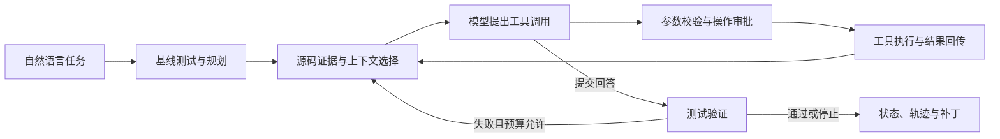

# ForgeCode｜CLI Coding Agent

面向 Git 仓库的终端 AI 编程助手：接收自然语言任务，检索源码、调用工具修改文件，并根据测试反馈继续修复，最终导出可审阅的补丁。

**技术栈：** Python / LangGraph / LangChain / Pydantic / SQLite / Git worktree

## 从这里开始

| 想了解什么 | 入口 |
|---|---|
| 运行一次完整演示，查看实际结果 | [可复现演示](docs/showcase-demo.md) |
| 安装项目、接入真实模型 | [运行说明](docs/quickstart.md) |
| 理解组件接口与设计取舍 | [架构说明](docs/architecture.md) |
| 检查实现和测试 | [源码](forgecode/) · [测试](tests/) |

## 一个任务怎样完成

`answered` 表示模型提交回答；`verified` 表示用户指定的验证命令通过。任务效果还可以由独立验收器检查。

## 关键设计

### 测试反馈驱动的执行闭环

基线测试提供初始事实；修改后的测试失败输出进入下一轮模型请求。模型请求次数、工具尝试次数和回修次数分别受预算约束。

源码：[运行逻辑](forgecode/agent/runtime.py) · [状态图](forgecode/agent/graph.py) · [验证测试](tests/test_verification.py)

### 文件修改与任务进度之间的中断恢复

Checkpoint 保存任务进度，动作回执记录操作的预期效果与结果。编辑发生后、进度保存前中断时，恢复流程核对文件内容指纹，复用结果或补写回执；无法确认的命令效果转为 `needs_review`。

源码：[动作回执](forgecode/execution/receipts.py) · [工具执行](forgecode/tools/registry.py) · [恢复测试](tests/test_recovery.py)

### 有限上下文中的源码与工具结果

Python AST 与词项匹配提供源码候选；按内容指纹复用解析。模型请求按字符预算选择历史，保护当前目标和最新完整工具交互；长结果保存到外部，提供预览与按需回读。

源码：[上下文构建](forgecode/context/builder.py) · [源码检索](forgecode/context/repository.py) · [结果存储](forgecode/tools/results.py)

### 受控执行与可检查的产物

工具通过 Pydantic 参数校验、风险审批和统一结果返回；仓库任务在 Git worktree 中修改，支持命令超时、取消、补丁导出与 JSONL 轨迹。

## 当前验证与边界

- **本次复跑（2026-10-26）：** 离线机制演示完成，基线失败、最终验证通过，发生一次回修，原仓库保持不变。[结果与复现步骤](docs/showcase-demo.md)
- **发布前验证（2026-10-26）：** 在本仓库副本执行 57 项自动化测试，全部通过；22 道验收器自检题全部通过。[验证记录](examples/validation.json)
- **评测入口：** 支持真实模型任务验收、同题重复与模块对照；本页不提供尚未取得的真实模型成功率或成本收益。
- **当前范围：** 单 Agent；上下文采用规则裁剪与结果回读，未实现语义摘要；恢复按单执行所有者设计。Git worktree 分离代码改动，不能替代操作系统级沙箱。

## 代码来源与演进

本项目从 [forgecode-agent](https://github.com/yxccai/forgecode-agent) 的既有实现整合与扩展，将交互、仓库任务、演示和评测汇入同一套 Runtime，并完善测试回修、工具执行协议、上下文选择和中断恢复。本仓库仅整理统一版运行代码、测试和展示文档，原始演进记录保留在来源仓库。
