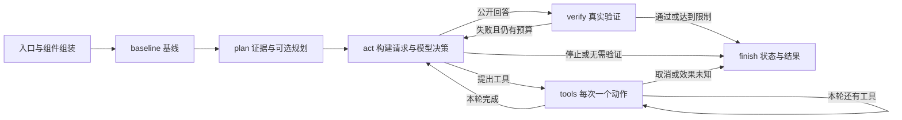

# 一个主版本：模块、接口与完整调用链

学习顺序按依赖理解展开：模型与循环 → 工具 → 上下文 → 状态 → 记忆 → 规划与反馈 → 执行控制 → 轨迹与评测。执行时先做基线检查，再规划和行动；学习顺序帮助理解组件，运行顺序依据任务需要。

## 一张运行图



聊天、单次任务、离线学习、评测分别组织输入与环境，使用同一 Runtime、State、运行图和 ToolRegistry。Session 是会话管理者，不继承 Runtime 来另写工具节点。教学的 ScriptModel 仅固定回复，正式运行的 Model 调用配置端点；后面的执行代码相同。

## 模块接口表

| 模块 | 输入 | 输出 | 主要调用者 | 可以替换什么 |
|---|---|---|---|---|
| Model.complete | 本次消息、工具定义、事件回调 | AIMessage，可能含工具请求与 usage | Runtime.act、planning.generate | 模型端点与适配器 |
| ContextBuilder.build | State、来源核对后的证据 | 完整消息组与字符统计 | act、generate | 选择、压缩、精确 token 计量 |
| Repository.select | 任务词、字符预算 | 路径、符号、内容指纹、评分、缓存统计 | ContextBuilder、repo_map 工具 | 语义/混合检索、重排 |
| Memory.recall | 查询 | 来源有效的记忆和验证标记 | ContextBuilder、工具 | 检索策略与长期存储 |
| ToolRegistry.prepare | 工具名、JSON 参数 | schema 校验后的 spec 与参数 | tools_node、execute | 增加注册工具 |
| Policy.permitted | 工作区、工具、参数、调用 ID、风险、Grant | 是否允许此次执行 | ToolRegistry.execute | 更细策略或远端审批 |
| ToolRegistry.execute | 同上，加稳定动作 ID | 统一 ToolResult | Runtime.tools_node | 工具实现与执行后端 |
| Verification.run | 用户给定 argv | 退出码、输出、超时、取消、passed | baseline、verify | 业务验证器 |
| Runtime 节点 | 唯一 State | 变化字段字典 | graph | 路由与受控执行策略 |
| Trace | 程序事实事件 | 脱敏 JSONL、界面事件 | Runtime、能力对象 | 存储与可观察界面 |
| 独立验收 | 任务定义、修改后的源文件 | 案例通过数、约束、success | evaluation.runner | 任务集与验收方法 |

返回变化字段是 LangGraph 的状态更新约定。例如 tools_node 返回 calls+1、cursor+1 与一条 ToolMessage。messages 使用 add_messages 合并；其他普通字段覆盖。observed_node 记录更新前后的摘要，不重新执行业务。

## 三种“保存”各自负责什么

State/checkpoint 保存任务进度：下一节点、消息、预算与游标。Trace 负责看发生了什么，不能替代恢复状态。Receipts 保存有副作用动作的开始、预期效果与完成结果，补足文件操作和图 checkpoint 之间的间隙。

完成回执可复用；编辑中断后核对文件 before/after 指纹；未知命令效果停止为 needs_review。单进程、单执行所有者是当前前提，没有宣称跨多个进程和任意外部系统的 exactly-once。恢复同一 thread 不要同时启动两个进程。

## 预算、错误与状态

steps 是 complete 接口的逻辑请求尝试次数，包含计划和失败请求；SDK 内部 HTTP 重试不单独计数。calls 是逐个工具尝试次数，包含拒绝和校验失败，未执行请求用 not_executed 闭合消息但不增加次数。token 来自响应后 usage，缺失另计；失败请求未取得用量也标为未知。这是事后软上限，不能保证单次调用绝不超限或精确费用上限。

answered 代表模型给出公开回答；verified 代表用户指定验证通过；verification_failed 代表失败且达到修复/预算限制。budget_exhausted、cancelled、needs_review、error 各有独立原因。独立验收 success 另外记录，公开测试通过仍可能遗漏边界。

工具失败返回 JSON 观察，由后续行动读取。模型或上下文异常停止为 error。取消由同一 CancelToken 传播到模型迭代和过程执行；网络阻塞期间仍受客户端 timeout 约束。Ctrl+C 在审批提示处保留 interrupt，/resume 继续；执行中的取消会停止本轮。

## 上下文与记忆为什么独立

完整历史保存在 State，模型请求是派生视图。必须保留当前目标和最新完整观察组；AI 工具请求与对应 ToolMessage 不拆散。长结果先以头尾预览展示，完整捕获通过 source_ref 回读。过程执行另有 2 MB 输出捕获上限，中间超限内容明确丢弃，结果存储不能找回这部分。

每次 act 都重新检索并核对记忆来源，避免源文件被编辑后仍把旧笔记作为有效证据。来源未变只表示 source_validated；verified 需要已有验证依据，两者不混淆。仓库文字和笔记按数据送入消息，不能当成更高权限指令。当前提示规则不能证明彻底阻止 prompt injection。

检索是英文/代码词的词项匹配与 Python AST 定位，适合源码名称；当前不包含向量模型、中文语义检索或模型摘要。先观察实际选中路径和 score，再依据测量改进。

## 执行环境与产物位置

task 模式在新 worktree 内允许精确编辑，普通模型命令要审批；interactive 直接作用于指定目录，编辑和命令均审批；readonly 拒绝非读取工具。基线与最终验证命令由用户预先指定。

路径守卫拒绝越界、内部目录、链接与敏感配置，Windows 下保护目录名称大小写同样校验。命令使用 argv 与 shell=False；Python 别名绑定当前解释器；传给子进程的环境去掉常见密钥变量。任意获批命令仍具有当前用户的系统权限，worktree 和路径检查不构成完整文件系统/网络沙箱。

Windows 使用 Job Object 清理进程树，无法绑定时对仍存活父进程尝试 taskkill；POSIX 使用进程组。Windows 实际验证通过，POSIX 路径本轮未在对应系统验证。子进程在加入 Job 之前有小的启动窗口，这也不能当作安全隔离保证。

学习产物在 artifacts/learning/run-*/；单次任务的 checkpoint、trace、receipts、结果与 patch 在目标样例仓库自己的 .forgecode/。评测临时仓库会清理，长期保留 trace、manifest、results.jsonl 与 summary。所有交付验证都使用本项目内的 fixture 与临时目录，没有操作上层原仓库。

## 扩展一个工具：保留同一执行路径

```python
from forgecode.tools.adapters import Args

class CountArgs(Args):
    path: str

def count_lines(path):
    """Count lines in a repository file."""
    target = runtime.tools.guard.path(path)
    return {"lines": len(target.read_text(encoding="utf-8").splitlines())}

runtime.tools.add("count_lines", count_lines, CountArgs, "read")
```

这段是注册方法的例子，需要在你拿到 runtime 后执行。参数必须继承禁止多余字段的 Args，风险只允许 read/write/command/memory，文档说明输入输出。不在 Runtime 中给工具名字加特殊分支；它自动经过 schema、Policy、ToolResult、计数与 Trace。有副作用工具还需设计自己的效果核对方式，当前自动编辑恢复只适用于 edit_file。

新增模型实现 complete(messages, tools, emit)；返回 LangChain AIMessage 与标准 tool_calls，不直接执行工具。支持 tools、streaming、usage 的端点能力在配置中明确。Model 持有自己的 HTTP 客户端，由入口关闭；不要关闭 SDK 共用的全局客户端。

新增检索保持证据格式，新增任务在 evaluation/tasks.py 定义错误源文件、指令、公开/独立案例和参考解。先自检 baseline 被拒绝、reference 被接受，再运行模型与配对消融。
